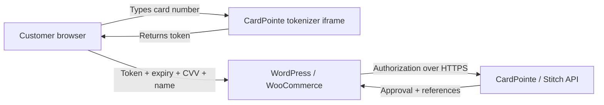

import MerchantSignup from '@site/src/components/MerchantSignup';

# Card data and privacy

<MerchantSignup />

This page explains what **Stitch Payments for WooCommerce** stores on your WordPress site, how card data is tokenized, and what you should disclose in your store privacy policy.

For saved-card behavior from a customer perspective, see [Stored payment methods](/docs/merchants/stored-payments).

## Summary

| Data type | Stored on your site? |
|-----------|----------------------|
| Full card number (PAN) | **No** — entered in a CardPointe hosted iframe; only a token is sent to your server |
| CVV / security code | **No** — never written to the database; held in memory only for the authorization request |
| Card tokenizer token | **Temporarily** on the order during checkout, then deleted after processing |
| Last four digits, card brand, expiry | **Yes** — on saved payment tokens (when the customer opts in) and in CardPointe merchant records |
| Transaction references | **Yes** — on orders for refunds, support, and accounting |
| API credentials | **Yes** — in WordPress options (encrypted at rest depends on your hosting) |

Card processing itself is performed by **Stitch / CardPointe** over HTTPS. Your site sends authorization requests; it does not store raw card numbers in the database.

## How card tokenization works

The card number field is not a normal HTML input on your site. It is loaded inside a **CardPointe hosted iframe tokenizer** (`ajax-tokenizer.html`). When the customer types their card number:

1. The number stays inside CardPointe’s tokenizer environment.
2. CardPointe returns a **single-use token** string to the checkout form.
3. Only that token (not the full card number) is posted to WordPress with the order.

Expiry, CVV, and cardholder name are collected in standard checkout fields on your site. They are required to complete the authorization. Since 0.8.0 none of them is written to the order: the token, expiry, name, and **CVV** are read from the checkout request, or held in memory for the rest of that request on Blocks checkout, and discarded after the authorization. The **CVV is never written to the database.** The CVV does pass through your server for that one request, because it is typed into a field on your page rather than inside the CardPointe iframe.

This design reduces PCI scope for your WordPress installation because sensitive card entry happens in CardPointe’s hosted field, not in your theme or database. Browser messages between the checkout page and the tokenizer iframe are restricted to the tokenizer’s own origin, so other scripts on the page cannot intercept them.

## During checkout — temporary data

Since 0.8.0 the plugin does not attach checkout fields to the order while it takes payment. On Blocks checkout the token, expiry, cardholder name, CVV, and the save-card choice are held in a request-scoped in-memory store for the duration of the authorization request and discarded immediately afterward. Bank account fields (routing and account number) are held the same way.

Versions before 0.8.0 briefly stored some of these fields as order meta during Blocks checkout. If an older order still has any of these keys, they are **removed in a cleanup step after every payment attempt**:

| Order meta key | Contents |
|----------------|----------|
| `_stitch_token` | CardPointe tokenizer token |
| `_stitch_card_expiry` | Expiry entered at checkout |
| `_stitch_card_name` | Cardholder name |
| `_stitch_save_payment_method` | Whether the customer chose to save the card |

The **CVV is deliberately excluded from order metadata** in every version, so it is never written to the database. Full card numbers never reach your server at all.

## After payment — what stays on orders

For refunds, voids, subscription renewals, and merchant accounting, the plugin keeps **non-sensitive transaction references** on WooCommerce orders (and related subscriptions):

| Order meta key | Purpose |
|----------------|---------|
| `_stitch_retref` | CardPointe transaction reference |
| `_stitch_authcode` | Authorization code |
| `_stitch_merchant_id` | Merchant ID used for the charge |
| `_stitch_profile_id` | CardPointe profile ID (when a saved profile was used) |
| `_stitch_acct_id` | CardPointe account ID within the profile |
| `_stitch_refund_retrefs` | Comma-separated refund transaction references |
| `_stitch_surcharge_amount` | Surcharge amount returned by CardPointe. The same amount is the Credit card surcharge fee on the order |
| `_stitch_capture_status` | Authorize-only lifecycle: `authorized`, `captured`, or `voided` (since 0.5.0) |
| `_stitch_auth_attempt`, `_stitch_processor_order_id` | Which authorization attempt this is and the order ID sent to CardPointe for it. The first attempt sends the plain order ID; a retry sends a suffix such as `123-2` (since 0.8.0) |
| `_stitch_surcharge_unconfirmed` | `yes` when the order was paid without CardPointe confirming its card fee (since 0.8.0). See [Surcharge](/docs/merchants/surcharge#when-the-fee-cannot-be-confirmed) |
| `_stitch_avs_response`, `_stitch_cvv_response`, `_stitch_verification_hold`, `_stitch_verification_void` | Address and security code results and any hold or void they caused. See [Address and CVV checks](/docs/merchants/card-checks) |
| `_stitch_ach_account_type`, `_stitch_ach_last4`, `_stitch_ach_funding_status`, `_stitch_ach_return_code` | Bank payment details: account type, last four digits, funding state, and any bank return code |
| `_stitch_ach_authorization` | The debit authorization the customer accepted: the text, the amount, when they accepted it, and their IP address (since 0.8.0) |

These records are **intentionally kept** even if you enable plugin data removal on uninstall, so you retain payment history for accounting and chargebacks.

## Saved payment methods

When [stored payment methods](/docs/merchants/stored-payments) are enabled and the customer opts in, cards are saved as standard WooCommerce credit card tokens (type `CC`, gateway `stitch`), the same kind other card gateways use, so WooCommerce, Checkout Blocks, My Account, and Subscriptions show them natively. Each token stores:

| Field | Description |
|-------|-------------|
| Card type | Card brand (Visa, Mastercard, American Express, Discover) |
| Last four | Last four digits for display |
| Expiry month and year | For display and for the Card Account Updater |
| `stitch_profile_id` | CardPointe customer profile identifier (token meta) |
| `stitch_acct_id` | CardPointe account identifier within that profile (token meta) |
| `stitch_environment` | `test` or `live` — where the card was saved (token meta, since 0.8.0) |
| `stitch_merchant_id` | The card merchant ID the profile belongs to (token meta, since 0.8.0) |

The cardholder name is not stored on the token. A card is saved only when CardPointe returns a card type, last four, and expiry for it.

A CardPointe profile only exists in the environment and merchant account that created it, so a card saved in Test Mode is never offered or charged in live mode, and a card saved under one merchant ID is not charged under another. A card with no recorded environment or merchant is never offered.

The token’s internal reference is a combination of profile and account IDs — **not** a full card number. CardPointe holds the vaulted payment credentials; your site stores opaque IDs plus display metadata.

Customers can delete saved cards from **My Account → Payment methods**. That removes the WooCommerce token and deletes that card's account on the CardPointe profile. Other cards stored on the same profile are left in place.

### Customer profile identifier

Logged-in customers who save a card also have user meta `_stitch_profile_ids`, linking their WordPress account to a CardPointe profile for future saved cards. It holds one profile per environment and merchant, for example `live:496160873888`. Each customer keeps a single profile per environment and merchant, so new cards are added to it instead of creating another.

Customers who saved a card before 0.8.0 only have the older single value `_stitch_profile_id`. The plugin keeps reusing that profile, as long as none of the customer's saved cards say it belongs to a different environment or merchant, and copies it into `_stitch_profile_ids` the first time it is needed.

## Data sent to Stitch / CardPointe

Payment requests are sent to your configured CardPointe REST API base URL (test or production). Typical authorization payloads include:

- Token or saved profile/account identifiers
- Order amount and currency
- Billing name and address from the WooCommerce order
- CVV and expiry (for new-card payments)
- Merchant ID and capture settings (immediate charge vs authorize-only)

All communication uses **HTTPS**. API username and password are stored in the gateway settings option `woocommerce_stitch_settings` in your WordPress database. That option is **not autoloaded** — it is read only when the gateway needs it — and saved passwords are never pre-filled back into the admin settings form.

## Logging

The plugin can write to **WooCommerce logs** (`wp-content/uploads/wc-logs/`):

| Log source prefix | Typical use |
|-------------------|-------------|
| `wc-stitch` | Gateway and payment events |
| `wc-stitch-api` | API request/response diagnostics |
| `wc-stitch-surcharge` | Surcharge-related API calls |

API logging **redacts** sensitive fields before writing log lines: `token`, `account`, `cvv` / `cvv2`, passwords, and, since 0.8.0, customer personal data such as name, address, city, region, postal code, phone, email, and expiry.

Failed API calls are always logged. Successful calls are logged only while **Debug log** (under **Other settings**) is on, so leave it off except when troubleshooting.

Payment-complete log entries record only order and transaction references by default. **Enhanced debug logging** (under **Other settings**) adds customer details (user ID, email, billing name, postal code) to those entries for troubleshooting. Keep it **disabled in production** unless support asks you to enable it temporarily, so personal data stays out of your logs.

## Plugin configuration stored in WordPress

| Storage | Contents |
|---------|----------|
| `woocommerce_stitch_settings` | Gateway title, credentials, checkout display toggles, surcharge settings, capture mode, debug logging, uninstall cleanup preference (not autoloaded) |
| `woocommerce_stitch_ach_settings` | Bank account gateway settings, including the ACH merchant IDs (not autoloaded) |
| `stitch_payments_surcharge_unconfirmed` | Timestamps of orders paid without a confirmed card fee, kept for 7 days to drive the admin warning (since 0.8.0) |
| Validation transients | Short-lived admin notices after credential checks |
| WooCommerce payment token tables | Saved Stitch cards (`CC` tokens with gateway `stitch`) when customers opt in |
| User meta `_stitch_profile_ids` | CardPointe profile link per customer, per environment and merchant (since 0.8.0) |
| User meta `_stitch_profile_id` | The single profile link written before 0.8.0, still read |

## Deactivation and uninstall

| Action | Effect |
|--------|--------|
| **Deactivate plugin** | No data is deleted |
| **Delete plugin** (default) | Settings, tokens, profile IDs, transients, and plugin log files **remain** |
| **Delete plugin** with **Remove plugin data when the plugin is deleted** enabled | Removes gateway settings, saved Stitch cards, customer profile identifiers, transients, and plugin log files — **order and subscription payment metadata listed above is still retained** |

Review these options under **WooCommerce → Settings → Payments → Stitch → Data Retention**. The settings screen includes a **Data retention reference** summary you can copy into your site privacy policy.

## Privacy policy and compliance

As the store owner, you are responsible for your site’s privacy policy and lawful basis for processing customer data. Consider documenting:

1. **Payment processor** — Stitch / CardPointe processes card payments on your behalf.
2. **What you collect** — billing details, order history, and (if enabled) saved payment method display data.
3. **What you do not store** — full card numbers and CVV after checkout completes.
4. **Customer choices** — guests can pay with a new card; saved cards require a logged-in account and explicit opt-in at checkout (except subscription flows that require a reusable method).
5. **Retention** — order payment references are kept for accounting; uninstall cleanup options above.
6. **Third-party transfer** — payment data transmitted to CardPointe for authorization, capture, refunds, voids, and stored profiles.

This documentation is a technical reference for merchants and is **not legal advice**. Consult qualified counsel for PCI, GDPR, CCPA, or other regulatory obligations in your jurisdiction.

## Quick reference in admin

Open **WooCommerce → Settings → Payments → Stitch**, scroll to **Data Retention**, and click **View data retention reference** to expand the live policy summary generated from the plugin’s retention rules — useful when updating your privacy policy or answering customer data requests.
